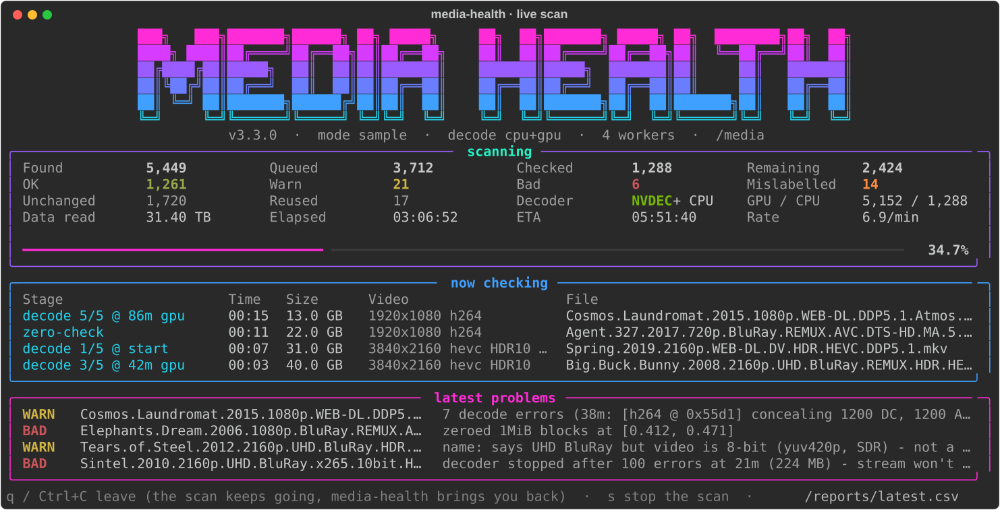
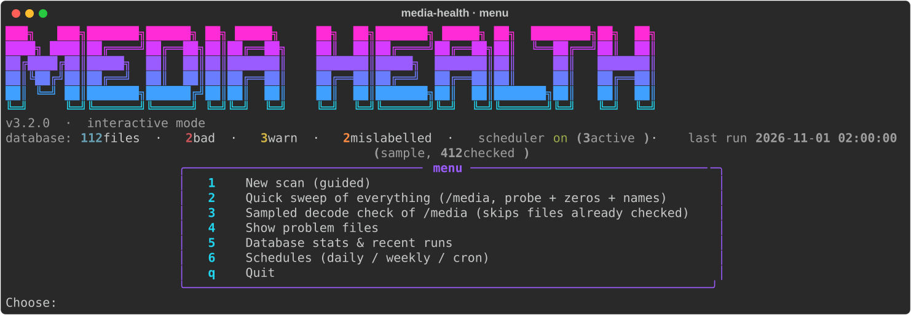
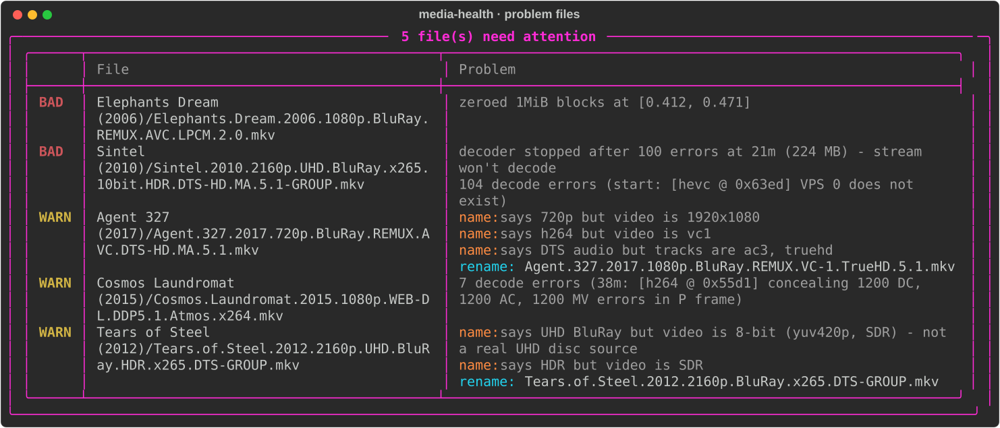
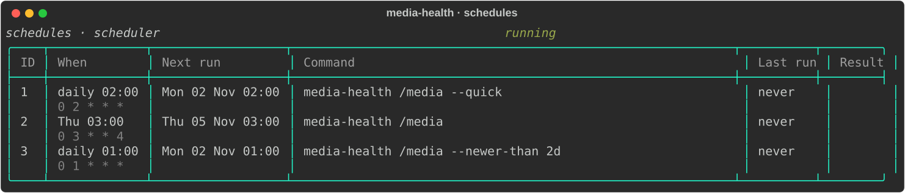

<p align="center">
  <a href="https://github.com/Jarsky/media-health/actions/workflows/ci.yml"></a>
  <a href="LICENSE"></a>
  
  
  
</p>

# media-health

Finds **damaged, broken and mislabelled** files in a Plex / Jellyfin / Emby library, before a viewer does.

It runs in a container with ffmpeg and mounts your library read-only. Every file gets these checks:

- probe the container
- look for zeroed blocks
- decode samples of the video, on the CPU or an NVIDIA GPU
- check that the name matches the streams. A `2160p UHD BluRay HDR` file that is really 1080p 8-bit SDR gets flagged.

Results go into SQLite, so later runs only check new or changed files.



## Features

- **Finds broken files.** Unparseable containers, missing video streams, zeroed blocks (failed copies, bad sectors), streams without headers, decoders that time out or run out of memory, and damaged slice data.
- **Finds mislabelled files** and suggests the corrected name. Covers resolution, UHD BluRay vs 8-bit encodes, HDR / HLG / Dolby Vision, 10-bit, video codec, REMUX bitrate and audio formats (TrueHD, Atmos, DTS, DD+…).
- **Incremental.** Unchanged files are skipped. A renamed, moved or hardlinked copy of a file already checked (e.g. after Radarr/Sonarr imports it) is recognised by fingerprint, and its result is reused.
- **Fast.** NVIDIA GPU decoding is optional. A stream that floods errors is stopped early, so broken files take seconds instead of minutes.
- **Interactive.** A live full-screen dashboard, a menu, guided scans, paged problem lists and Tab completion.
- **Scans outlive your terminal.** Scans run in the container's scheduler and your terminal only watches. Close it, lose the connection or press `q`; the scan carries on, and running `media-health` again brings its live dashboard back.
- **Scheduled.** Plain-English schedules (`daily 2am`, `mon,thu 03:30`, `every 6h`) or cron.
- **Reports.** A CSV per run plus the SQLite database to query directly.

## Quick start

```bash
git clone https://github.com/Jarsky/media-health.git
cd media-health
cp .env.example .env          # set MEDIA_PATH, PUID/PGID (a user that can read it) and TZ
docker compose up -d --build  # container "media-health": scheduler + your shell for scans

docker exec -it media-health media-health      # interactive menu
```

Or from a shell inside the container:

```bash
docker exec -it media-health bash
media-health /media --quick                     # whole library, ~1 s per file
media-health /media                             # sampled decode check (the default depth)
media-health /media/tv --newer-than 7d          # what arrived this week
media-health /media --only bad,warn --full      # full decode of only the files already flagged
media-health                                    # a scan is running? this takes you back to it
media-health -h                                 # every option, grouped, with examples
```



## NVIDIA GPU (NVDEC)

With an NVIDIA GPU and the [NVIDIA Container Toolkit](https://docs.nvidia.com/datacenter/cloud-native/container-toolkit/latest/install-guide.html) installed, add this to `.env` and run `docker compose up -d` again:

```bash
COMPOSE_FILE=docker-compose.yml:docker-compose.gpu.yml
```

`--gpu auto` (the default) uses the GPU when one is available. The menu header shows `GPU NVDEC ready` when the container can see it. During a scan, the dashboard's **Decoder** cell shows what's decoding (`NVDEC + CPU`, `CPU`, `CPU (no GPU found)`), and **GPU / CPU** counts the decode points run on each.

| `--gpu` | Sampled scan | `--full` |
|---|---|---|
| `auto` | start on the CPU, the other points on the GPU | CPU |
| `on` | everything on the GPU | GPU |
| `off` | CPU | CPU |

**Why the start stays on the CPU:** NVDEC (and any hardware decoder) silently conceals damaged slice data. Only the software decoder reports those errors (`cu_qp_delta outside the valid range`, `CABAC_MAX_BIN`…). It is also what measures decoder memory. Stream headers are parsed in software either way, so headerless or truncated streams are caught on both.

Measured on an RTX 4060 with 4K HEVC remuxes over SMB (seconds per file, sampled scan):

| File | v3.1 (CPU) | v3.2 `--gpu off` | v3.2 `--gpu auto` |
|---|---:|---:|---:|
| 4K HEVC, 2 h 22 m | 78.0 | 35.7 | |
| 4K HEVC DV, 1 h 43 m | 82.7 | | 7.0 |
| 4K HEVC, 1 h 49 m | 68.5 | | 7.4 |
| 1080p AVC remux | 35.2 | 12.5 | 6.1 |
| 4K HEVC, broken stream (no VPS/SPS) | 223.8 | | 6.6 |

Blank = not measured. `--gpu off` is faster than v3.1 because each decode point now starts at the keyframe before it (`-noaccurate_seek`) instead of decoding up to it and throwing those frames away.

## Checks

| Check | Catches |
|---|---|
| ffprobe | a container that can't be parsed, a missing video stream |
| zero blocks | 1 MiB samples at 18 points that are all zero bytes |
| decode samples | 5 s decoded at the start and at 4 points, counting serious errors. A timeout or an error flood makes the file BAD and skips the remaining points |
| decoder memory | peak RSS of the CPU decode. WARN above 1500 MB (`--rss-warn`). A decoder killed by the memory cap = BAD |
| name check | what the file name claims vs. what the streams are (below) |
| profile (info) | codec, HDR10/HLG, Dolby Vision profile, audio, bitrate. Notes DV profile 5/7 (no HDR10 fallback → tone-map transcodes) |

Depth: `--quick` = probe + zero blocks + name check. The default = + decode samples. `--full` = decode every frame.

**Status:** **BAD** = probe failure, zeroed data, ≥3 serious decode errors (`--bad-threshold`), a killed, timed-out or flooded decoder. **WARN** = a few decode errors, high decoder memory or a mislabel (`--mislabel warn|bad|info|off`).

### Name check

| Name says | Must be |
|---|---|
| `2160p` / `4K` / `UHD` · `1080p` · `720p` · `576p`/`480p` | that resolution (cropped scope like 3840x1600 is fine) |
| `UHD BluRay` | 10-bit. 8-bit means it is not a real UHD disc source |
| `HDR` / `HDR10` / `HDR10+` · `HLG` · `DV` / `DoVi` | PQ transfer · HLG transfer · Dolby Vision metadata |
| `10bit` | a 10/12-bit pixel format |
| `x265`/`HEVC` · `x264`/`AVC` · `AV1` · `VC-1` · `MPEG2` · `XviD`/`DivX` | that video codec |
| `REMUX` | not also tagged x264/x265, and at least 25 Mbps (4K) / 12 Mbps (1080p) |
| `TrueHD` · `Atmos` · `DTS`/`DTS-HD`/`DTS-X` · `DDP`/`EAC3` · `DD`/`AC3` · `AAC` · `FLAC` · `LPCM` | a track of that kind exists |

**Suggested names.** The problem list and the CSV (`suggested_name` column) show the name corrected to match the streams. Nothing is renamed automatically: Radarr/Sonarr own the names, so use the suggestion when you rename the file yourself.
- Claims the streams don't support are **dropped**: HDR, HLG, DV, 10bit, `UHD` on an 8-bit source, and `REMUX` on an encode or a low bitrate. Nothing like "8bit" or "SDR" is added.
- A wrong **resolution** or **video codec** is replaced with the real one (`2160p` → `1080p`, `AVC` → `VC-1`).
- A wrong **audio** format is replaced with the main track (`DTS-HD.MA.5.1` → `TrueHD.5.1`). The channel layout is kept, and secondary tracks (e.g. the AC3 alongside a TrueHD) are never added.



## Schedules

The `media-health` container runs a scheduler. Schedules live in the database. You can manage them from the menu (option 6) or the command line:

```bash
media-health /media --quick --schedule-add "daily 2am"           # quick sweep every night
media-health /media --schedule-add "thu 3am"                     # sampled check every Thursday
media-health /media --newer-than 2d --schedule-add "daily 1am"   # new arrivals, nightly
media-health --schedule-list                                     # next run, last run, result
media-health --schedule-run 1        # run now   (--schedule-pause / --schedule-resume / --schedule-rm)
```

**WHEN** is plain English or 5-field cron. For example: `daily 2am`, `thu 3am`, `every thursday at 3am`, `mon,thu 03:30`, `fri-sun 11pm`, `weekdays 1am`, `weekends 4:15am`, `monthly 15 03:00`, `hourly`, `every 6h`, `*/30 1-5 * * mon-fri`. Times follow `TZ` from `.env`.

- One scheduled scan runs at a time. If a scan is already running, the scheduled one waits for it. Missed times (container down) are skipped.
- Each run logs to `reports/logs/schedule-<id>-<time>.log` (kept 60 days) and to `docker logs media-health`.
- Interactive scans go through the same scheduler, one at a time. `--background` queues a scan without watching it.



## Interactive use

- **Scans run in the scheduler.** Starting a scan from the menu or with `media-health <path> …` hands it to the scheduler in the `media-health` container. Your terminal then shows its live dashboard: totals, ETA, what each worker is decoding, and the latest problems.
- **Leaving and coming back.** `q`, Esc, Ctrl+C or a dropped connection only stops watching. Run `media-health` again (or pick **w** in the menu) to get the dashboard back. This works from any shell, including another `docker exec`.
- **Stopping.** Press `s` on the dashboard, or `docker stop`. The files in progress finish, everything is saved, and the next run carries on where it stopped.
- **Without the scheduler** (e.g. `pip install` on a host, or `--plain`), a scan runs in your terminal, and closing the terminal stops it. Without a terminal (`--plain`, `docker logs`) it prints a status line every 30 s plus each problem file.

## Filters

| Flag | |
|---|---|
| `--name TEXT` | case-insensitive match on the path. Plain text = contains, `* ? [ ]` = glob |
| `--match REGEX` | regex on the path |
| `--newer-than AGE` / `--older-than AGE` | file modified time. AGE = number + `min`, `h`, `d`, `w`, `mo`, `y` |
| `--min-gb N` | only files at least N GB |
| `--limit N` | stop after queueing N files |
| `--force` | ignore the database and rescan everything that matches |
| `--only KINDS` | recheck only the files the database already flags under PATH: `bad`, `warn` and/or `mislabelled`, comma-separated. Implies `--force`, and drops flagged files that no longer exist. With `--full`, a full decode confirms suspects. In the menu, press **r** in the problem list |

## Database and reports

`reports/media-health.db` (SQLite):
- `files`: one row per file, with status, problems, name issues and stream details.
- `runs`: one row per scan.
- `schedules`: the schedules.

A file is **skipped** when its path, size and mtime are unchanged and it was already checked at least as deeply (full > sample > quick). A file not seen before is **fingerprinted**: its size plus a hash of its first, middle and last 1 MiB. If an identical file was already checked, that result is reused. After a complete, unfiltered scan of a folder, rows for deleted files are removed.

Each run writes `reports/media-health-<time>.csv` (and `latest.csv`), BAD first.

```bash
sqlite3 reports/media-health.db "select path, problems from files where status='BAD'"
```

## Configuration

Everything is set in `.env`. See [`.env.example`](.env.example):

| Variable | Default | |
|---|---|---|
| `MEDIA_PATH` | — (required) | the library, mounted read-only at `/media` |
| `PUID` / `PGID` | `1000` | the user scans run as. It must be able to read the library |
| `TZ` | `Etc/UTC` | the time zone schedules run in |
| `MEM_LIMIT` / `CPUS` | `2g` / `4` | container caps. A decoder killed by the cap marks the file BAD |
| `COMPOSE_FILE` | — | add `docker-compose.gpu.yml` for NVDEC |

To run without Docker, install ffmpeg, then `pip install .` and `media-health --reports ./reports /path/to/media`.

## Development

```bash
python -m venv .venv && . .venv/bin/activate
pip install -e '.[dev]'
ruff check . && pytest
python docs/screenshots.py      # regenerate the README screenshots from demo data
```

[CONTRIBUTING.md](CONTRIBUTING.md) covers the branch, commit and release workflow. [CHANGELOG.md](CHANGELOG.md) lists the changes in each version.

## License

[MIT](LICENSE) © 2026 Jarsky
